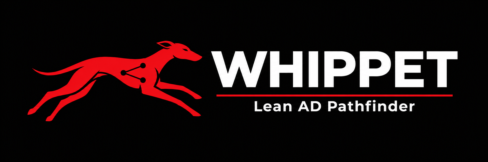

# Whippet

**A lean, fast in-memory Active Directory graph pathfinder — the lightweight sibling to BloodHound.**

No Neo4j. No JVM. No Cypher. No kennel. Just a zero-dependency Python package that ingests the exact same SharpHound output BloodHound uses and answers the questions you actually care about — *who can reach Domain Admins, what can this account touch, how do these privileges chain* — straight from the command line on your Kali box. And when you *do* want to see the graph, an optional one-command browser visualizer is built in.

```
$ python3 whippet.py BloodHound.zip --from "JSMITH@CORP.LOCAL" --to "DOMAIN ADMINS@CORP.LOCAL" --exhaustive

  All Paths (up to 20, exhaustive, ≤3 hops): JSMITH@CORP.LOCAL → DOMAIN ADMINS@CORP.LOCAL
  ────────────────────────────────────────────────────────────────────
  [1]  (2 hops)
       JSMITH@CORP.LOCAL ─[GenericAll]→ SVC_SQL@CORP.LOCAL ─[MemberOf]→ DOMAIN ADMINS@CORP.LOCAL
```

---

## HTB lab workflow

See the [HTB CLI guide](docs/HTB.md) for account triage, group-derived ACL leads,
LAPS/gMSA and delegation findings, routes from multiple owned accounts, Certipy
JSON import, and NetworkX ranked alternative paths.

```bash
whippet bloodhound.zip --triage 'USER@LAB.HTB' --limit 5
whippet bloodhound.zip certipy_find.json --findings adcs
whippet bloodhound.zip --from 'USER@LAB.HTB' --to 'DOMAIN ADMINS@LAB.HTB' --k-shortest 5
```

Ranked paths require the optional `analysis` extra (`networkx`). Whippet reuses
Certipy assessments rather than recreating its ESC rules. This supports common
lab investigation workflows but does not establish complete BloodHound parity.

## GPOs and trusts

Whippet interprets GPO scope with inheritance blocks, enforced links and disabled
sections, imports collector-computed GPO access rights, and reports directional
trust authentication flows and receiver-side filtering conditions.

```bash
whippet bloodhound.zip --gpo-scope 'POLICY@LAB.HTB'
whippet bloodhound.zip --trust-path 'CHILD.LAB.HTB' 'LAB.HTB'
whippet bloodhound.zip --format json --from 'USER@LAB.HTB' --to 'PC.LAB.HTB' --profile potential
```

The opt-in `potential` profile adds conditional policy and same-forest
SID-history steps with evidence. Default supported routes keep these separate
from ordinary collected privilege edges. See the [GPO and trust guide](docs/POLICY_TRUST.md)
for field semantics, prerequisites, batch requests, and remaining RSoP limits.

## Evidence-aware AD handoffs

Whippet 0.8 distinguishes graph possibilities from live access, explains empty
route scope without discarding triage leads, and returns one complete lead:

```bash
whippet capture.zip --handoff 'ACTOR@LAB.HTB' --lead-query acl-control
```

See [AD assessment evidence and handoffs](docs/AD_ASSESSMENT_HANDOFF.md) for the
sanitized Forest case study, next verification questions, and the session-local
trusted-host overlay prototype. Model-facing queries cannot assert verified access.

## HARP integration

For integration in another Codex chat, start with the complete
[HARP batch handoff](docs/HARP_BATCH_HANDOFF.md). It documents selected-Kali
runtime ownership, readiness, process reuse, request/response IDs, event logging,
timeouts, shutdown, all query modes, and the reusable Python client.

```bash
whippet bloodhound.zip --batch --batch-ready
```


Whippet now has versioned, compact JSON reports for agent use:

```bash
whippet bloodhound.zip --summary --from 'JSMITH@CORP.LOCAL' --limit 10
whippet bloodhound.zip --search 'svc'
whippet bloodhound.zip --node 'SVC_SQL@CORP.LOCAL'
whippet bloodhound.zip --findings dcsync
whippet bloodhound.zip --objects computer --where enabled=true --select name operatingsystem
whippet bloodhound.zip --batch
```

Summaries use a single BFS to find candidate routes and include totals and
truncation markers. JSON path queries avoid alternate-path enumeration unless
`--all-paths` is requested. See the [HARP integration guide](docs/HARP.md) for the
output contract, workflow, and Python API, and the [correctness review](docs/REVIEW.md)
for fixed bugs and remaining limitations. Graph paths are leads that require
verification. Supported JSON routes now compose DCSync rights across nested
memberships and retain supporting evidence. Findings queries, exact property
filters, pagination, and load-once JSON requests reduce what HARP needs to ingest.
See the [CLI parity matrix](docs/PARITY.md). Whippet does not yet implement all
BloodHound post-processing.

## Why

BloodHound is excellent, but for a lot of day-to-day work it is heavier than the problem requires. Standing up Neo4j, importing the data, opening the GUI, and clicking through *Shortest Paths to Domain Admins* is a lot of ceremony when all you want is a fast, scriptable answer you can pipe into a report.

Even a large enterprise AD is typically tens of thousands of nodes and a few hundred thousand edges — a graph that fits comfortably in a few hundred MB of RAM. Neo4j's disk-backed page cache, Bolt protocol, and Cypher parsing are overhead you don't need for the targeted traversals (shortest path, reachability, transitive membership) that make up the vast majority of BloodHound usage.

Whippet stores the whole graph in plain Python adjacency lists and answers those queries with BFS/DFS. No server to manage, no import step, and queries return in milliseconds.

Whippet's targeted queries use Python BFS/DFS. No comparative timing claims
are made here without a reproducible benchmark. Import time and memory use
depend on the capture, and enumerating alternate paths can be expensive.

---

## Requirements

- **Python 3.9+** — that's it. The core runs entirely on the standard library.
- **`igraph`** *(optional)* - a graph mirror is available through the Python API.
  Current CLI and GUI queries use Python BFS/DFS. Installing igraph does not
  accelerate these queries, and the CLI does not build an unused mirror.
- **`flask`** *(optional)* — only needed for the in-browser visualizer (`--serve`). `pip install "flask"` or `pip install "whippet-ad[web]"`. The CLI never imports it.

No required third-party packages. Drop the `whippet/` folder on your Kali box and run `python3 whippet.py …`.

---

## Input

Whippet ingests the same data BloodHound does — the JSON produced by [SharpHound](https://github.com/SpecterOps/SharpHound). It accepts:

- A **SharpHound ZIP archive** — `python3 whippet.py BloodHound.zip`
- A **directory** of extracted JSON files — `python3 whippet.py /path/to/output/`
- **Individual JSON files** — `python3 whippet.py *_users.json *_computers.json *_groups.json *_domains.json`

Both SharpHound v1 and v2 (BloodHound CE) output formats are supported. For full coverage, collect users, computers, groups, and domains — group and domain data is what lets Whippet resolve SIDs to names and identify high-value targets.

---

## Usage

```
python3 whippet.py INPUT [INPUT ...] [options]
```

Run with no query options for raw reachability to each detected high-value target, plus a target inventory.

### Options

| Option | Description |
|---|---|
| `--format json` | Versioned JSON with bounded collections |
| `--summary` | Compact JSON inventory and routes from a known principal |
| `--node NODE` | JSON object properties and incoming/outgoing relationships |
| `--search TEXT` | JSON name discovery with truncation marker |
| `--limit N` | Rows per JSON collection, default 20 |
| `--all-paths` | Opt into alternate paths for JSON source/target queries |
| `--from SRC` | Source node (user / computer / group name or SID) |
| `--to DST` | Target node (all detected high-value targets if omitted) |
| `--reachable NODE` | Show everything reachable **from** this node |
| `--transitive-members GROUP` | Fully expand nested group membership |
| `--hops N` | Maximum path depth (default: 6). Ignored when `--exhaustive` is set |
| `--exhaustive` | Search with no manual hop cap — bound is auto-computed from the graph (see below) |
| `--list-users` | List all user accounts with their security-relevant flags |
| `--user-flag FLAG [FLAG ...]` | With `--list-users`, show only users that have **all** the named flags set |
| `--enabled-only` | With `--list-users`, restrict to enabled accounts |
| `--max-paths N` | Cap the number of alternate paths printed (default: 20) |
| `-o, --output FILE` | Write the report to a file (ANSI colour stripped automatically) |
| `--serve` | Launch the optional in-browser graph visualizer instead of printing a report (needs `flask`) |
| `--host HOST` | Interface for `--serve` (default: `127.0.0.1`) |
| `--port PORT` | Port for `--serve` (default: `8000`) |
| `--no-browser` | With `--serve`, don't auto-open a browser |

---

## Examples

**Default — who can reach Domain Admins:**
```bash
python3 whippet.py BloodHound.zip
```

**Specific attack path, exhaustively:**
```bash
python3 whippet.py BloodHound.zip \
    --from "JSMITH@CORP.LOCAL" --to "DOMAIN ADMINS@CORP.LOCAL" --exhaustive
```

**Who can reach a Domain Controller within 4 hops:**
```bash
python3 whippet.py BloodHound.zip --to "DC01.CORP.LOCAL" --hops 4
```

**What can a compromised account reach:**
```bash
python3 whippet.py BloodHound.zip --reachable "JSMITH@CORP.LOCAL" --hops 3
```

**Fully expand effective membership of a group:**
```bash
python3 whippet.py BloodHound.zip --transitive-members "DOMAIN ADMINS@CORP.LOCAL"
```

**List all users with their security flags:**
```bash
python3 whippet.py BloodHound.zip --list-users
```

**List only enabled, kerberoastable users:**
```bash
python3 whippet.py BloodHound.zip --list-users --user-flag hasspn --enabled-only
```

**Save a report to disk:**
```bash
python3 whippet.py BloodHound.zip -o paths.txt
```

---

## Browser visualizer (optional)

Sometimes you really do want to *see* the graph. Whippet ships an opt-in,
self-contained web GUI — no Neo4j, no internet, no bundled JS frameworks. It's a
single Flask process serving a vanilla-JavaScript force-directed canvas, so it
runs fully offline on an air-gapped box.

```bash
pip install flask          # one-time, only for the GUI
python3 whippet.py BloodHound.zip --serve
```

That loads the graph once, starts a local server on `http://127.0.0.1:8000`, and
opens your browser. From the sidebar you can:

- **Who can reach a target** / **what a node can reach** — reverse and forward BFS, grouped by hop.
- **Attack path A → B** — shortest path plus all simple paths, highlighted on the canvas.
- **Transitive group members** — full nested expansion.
- **Neighborhood** — pull up a node and its immediate edges, then **click any node to expand** outward.
- Browse **high-value targets** and the **user listing** (with security flags) and jump straight to a node.

Nodes are coloured by object type (User / Computer / Group / Domain) with
high-value targets ringed; drag to rearrange, scroll to zoom, drag the canvas to
pan. The GUI talks to a small JSON API (`/api/path`, `/api/reach`,
`/api/transitive`, `/api/graph`, …) backed by the **same query engine** the CLI
uses — so the browser and the command line can never give you different answers.

The server binds to `127.0.0.1` by default (localhost only). Use `--host 0.0.0.0`
to expose it on the network — there is no authentication, so only do that on a
trusted segment.

---

## Features

### Queries

- **Shortest path** between any two nodes (BFS, early-exit).
- **Who can reach X** — a single reverse-BFS from the target instead of running a forward search from every principal. This is the key optimization: Whippet keeps a reverse adjacency index, so *"who can reach Domain Admins"* is one pass over the graph, not one pass per source.
- **What can X reach** — forward BFS from a source node, grouped by hop distance.
- **All simple paths** between two nodes (DFS), with output capped by `--max-paths`.
- **Transitive group membership** — full nested expansion via reverse `MemberOf` traversal.
- **High-value target inventory** — auto-flags Domain Admins, Enterprise Admins, DCs, `admincount=1` objects, and other privileged groups.

### User listing

`--list-users` decodes each account's security-relevant flags inline, so you can spot easy wins without opening the GUI:

```
  JSMITH@CORP.LOCAL   enabled, kerberoastable
  SVC_SQL@CORP.LOCAL  enabled, adminCount, kerberoastable, asrep-roastable
  BOB@CORP.LOCAL      pwdNotReqd
```

Recognized flags: `enabled`, `adminCount`, `kerberoastable` (SPN set), `asrep-roastable` (no pre-auth), `pwdNotReqd`, `pwdNeverExpires`, `unconstrained` / `constrained` delegation, `sensitive`, and `sidHistory`. Filter with `--user-flag` (AND semantics) and `--enabled-only`.

### Exhaustive search and work limits

`--exhaustive` removes the manual hop cap. Reachability uses BFS until its
frontier empties. Alternate-path DFS uses the reachable-set size minus one as
a safe upper bound on path length. This bound need not be the longest actual
simple path.

Alternate paths are capped by `--max-paths` and a 100,000 edge-expansion budget.
The text report, GUI, and JSON indicate when that work budget is exhausted.
`--exhaustive` does not override either cap. A result can therefore be incomplete
even with no manual hop limit.

---

## How it works

The graph lives in two mirrored adjacency lists:

```
_adj   : node → [(neighbor, edge_type), ...]   # forward
_radj  : node → [(neighbor, edge_type), ...]   # reverse
```

Edges are typed to match BloodHound's relationship model — `MemberOf`, `HasSession`, `GenericAll`, `WriteDacl`, `WriteOwner`, `ForceChangePassword`, `AllowedToDelegate`, `AdminTo`, `CanRDP`, `GetChanges`/`GetChangesAll`, and more. SIDs are resolved to readable names at load time, and each node is tagged with its object type (User / Computer / Group / Domain) from collector metadata, with a filename fallback.

The reverse index (`_radj`) is what makes the headline query cheap. *"Who can reach this node"* becomes a single reverse BFS — `O(V + E)` — rather than a forward search repeated from every principal — `O(V × (V + E))`.

### Project layout

The tool is organized as a small package so each concern is testable in
isolation, while `whippet.py` stays a drop-and-run launcher:

```
whippet.py            # thin launcher → whippet.cli:main
whippet/
  graph.py            # ADGraph — storage + BFS/DFS primitives
  loader.py           # SharpHoundLoader — JSON ingestion
  queries.py          # QueryEngine + result dataclasses (shared by CLI and GUI)
  report.py           # TextReporter — the console report
  cli.py              # argument parsing / entry point
  constants.py        # edge-type and security-flag vocabularies
  web/                # optional Flask GUI (server.py + static/ canvas frontend)
```

The key seam is **`QueryEngine`**: it runs the graph algorithms and returns plain
result objects, which the text reporter and the web API both render. Add a query
once in the engine and it shows up in both front-ends.

**On memory:** the graph keeps forward and reverse adjacency lists, properties,
identity indexes, and a set of unique typed edges. Memory varies with object and
property sizes. Measure the full process on representative data rather than
assuming a fixed per-edge size.

---

## A note on companion tooling

Whippet focuses on graph traversal. If you also want a flat findings report — Kerberoastable accounts, AS-REP roasting, dangerous ACEs on high-value targets, DCSync rights, unconstrained delegation, sessions on DCs — that pairs naturally alongside it as a separate pass over the same SharpHound input.

---

## Disclaimer

Whippet is intended for authorized security assessments, red-team engagements, and defensive analysis of Active Directory environments **you own or have explicit written permission to test**. You are responsible for ensuring your use complies with all applicable laws and the terms of your engagement. The authors assume no liability for misuse.
